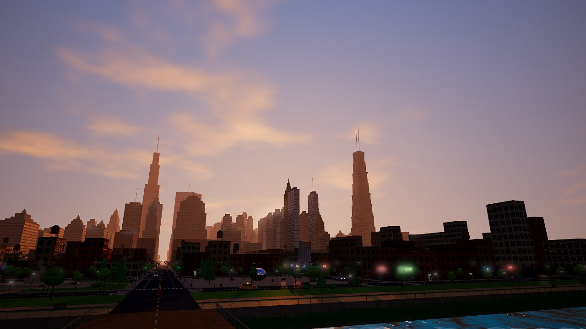

# Chicago Bois

A chaotic, slightly comedic 3D open-world crime sandbox set in a cartoon version of Chicago: a 16×16-block city with the Loop and its elevated train, a ballpark, a skyscraper going up under a tower crane, a beach with sailboats offshore, the Chicago River with steel bridges, tour boats and a riverwalk, the lakefront, Navy-Pier-style Ferris wheel and a skyline of art-deco and glass towers. Walk into shops and apartments, rob the till, crack locks, steal cars, race the streets and tag the alleys – and fill all **five wanted stars** before the cops put you in cuffs.

**Play:** https://edhb15.github.io/chicago-bois/



**Endast för dator** – the game needs a keyboard and mouse.

## Controls

| Key | Action |
|---|---|
| W A S D | Move / drive |
| Mouse | Look around (click the game to capture the mouse) |
| Shift | Sprint |
| Space | Jump · handbrake in a car |
| E | Interact: rob stores and – with a weapon out – any pedestrian or police officer (hold), pick locks, steal / enter / exit cars, hide in dumpsters, buy food or a disguise |
| Q / 1–4 / mouse wheel | Switch weapon: fists, baseball bat, crowbar, pistol |
| F / left click | Use the weapon: shove, swing the bat/crowbar (smashes props and car windows), fire the pistol |
| Right mouse | Aim the pistol over the shoulder |
| R | Reload the pistol (on foot) · car radio (in a car) |
| M | City map |
| H | Horn |
| Esc | Pause menu |

## How it works

- **Wanted meter:** every crime adds heat (minor +10%, medium +25%, major +40%, very major +60%). Repeating the same small crime within a minute gives less. Crimes done while cops are chasing you give ×1.25. 100% = one star; 500% = win.
- **Police response** grows with each star: suspicious officers (1), chase on sight (2), more units (3), tasers and ramming cruisers (4), and a helicopter with a spotlight (5).
- **Escaping:** break line of sight, duck into alleys, hide in dumpsters or bushes, or buy a disguise at a thrift store. When the search timer runs out you've escaped.
- **Smarter police:**
  - **Teamwork on foot:** officers split up. Two chase you, one runs to where you're heading to cut you off, and the rest fan out to the sides so you can't just run in a straight line.
  - **Driving:** the two closest cruisers chase you while the others race to the intersection ahead. If you stop, they park in front of, behind and beside your car, and officers get out to pull you out.
  - **Roadblocks:** from three stars, a fast car chase can end with two cruisers parked across the road ahead and armed officers behind them.
  - **Hearing:** gunshots, explosions and crashes during a chase give away where you are, even when nobody can see you.
  - **Searching:** when they lose you, they guess where you went from your speed and direction (the radio says "They think you went north"). Then they check every dumpster and bush nearby, one by one. A cop can open your dumpster and still miss you, but don't count on it at five stars.
  - **Pistol:** if you have a pistol out, they zig-zag towards you and reach for the taser sooner. At low wanted levels they hold back while you aim at them.
- **Busted:** officers next to you fill the arrest meter (shove them or run). If it fills, or your health hits zero, it's game over.

## Your character

Choose **CHARACTER** in the main menu. Pick one of six ready-made characters (Dre, Rosa, Big Tony, Maya, Jimmy, Kenji) or build your own: male or female body, slim/regular/heavy build, height, skin tone, nine hair styles and colours, facial hair, eye colour, cap or beanie, shades, T-shirt/long sleeves/hoodie/open jacket/tank top, long pants or shorts, shoe colour and a gold chain. Drag to turn the character, scroll to zoom. Your choice is saved in the browser. A disguise from the thrift store changes your clothes but keeps your face.

Everyone in the city is built the same way – proportioned bodies with knees and elbows, faces, hair styles and outfits – and walks, runs, sits and sunbathes with matching animations. Up close there's more detail:
- **Faces:** eyes that blink, eyebrows and lips that move, and teeth when they shout. Faces show fear when someone runs or is held up, and people look at you as you walk past.
- **Hands:** fingers and thumbs that curl into a fist when holding a gun.
- **Clothes:** shoe soles and laces, socks with shorts, collars, T-shirt prints, hoodie strings and zips, jacket lapels and belts with buckles.
- **Extras:** some people carry a backpack, watch, earrings or headphones, and they hold a phone when they call the cops.
- **Police:** a badge, name tag, shoulder mic and patches, a duty belt with holster, radio, cuffs and taser, and the checkered cap band.
- **Performance:** small details are only shown for people near the camera, so crowds stay fast.

## Around the city

- **Construction site** east of the Loop: a tower going up floor by floor behind a plywood fence, with a working tower crane (it turns, runs its trolley and lifts steel beams), an excavator, a cement mixer, a site office and a dumpster to hide in.
- **The beach** north of the river mouth: walk down the sand into the shallows. Umbrellas, sunbathers, swimmers, a volleyball game, a lifeguard chair, rock breakwaters and sailboats at anchor.
- **Parks** have basketball courts (pickup games on the one nearest to you) and playgrounds.
- **Streets**: bus shelters with lit ads, bike-share docks, food trucks, and billboards on shop roofs that light up at night.
- **Sky**: airliners cross over the city now and then, nav lights blinking.

## Walk-in buildings

Every store and many apartments have an open front door you can walk through. Stores are furnished to match – a bank with teller windows and a vault, jewelry display cases, electronics shelves, a pizzeria, a thrift store – and the robbery happens at the counter, right in front of the shopkeeper. Apartments have a living room to search for valuables (+10%; sometimes a stash under the mattress). The camera moves in over your shoulder indoors, and police follow you inside, so a shop with one door can turn into a trap.

## Activities

Mugging people with a weapon (+10%; robbing a cop +25% and they come after you), burgling walk-in apartments (+10%), gunfire (+5%; knocking people flat +10%, cops +20% – slapstick, they get back up), corner stores, pizzerias and the pawn shop (+25%), electronics and jewelry stores (+40%), the Second City Savings bank vault (+60%), ATMs (+25%), apartment back doors (+25%), warehouses and penthouses (+40%), the armored truck (+60%), parked cars / police cruisers / carjackings, street races (+40%), stunt ramps (+25%), speed cameras, graffiti and smashing street props (+10%).

## Graphics settings

- **High** (default): 4096 px sun shadows, glowing neon and lights, bloom, MSAA and sharpening, filmic (ACES) colour grading, and real-time reflections of the skyline in the lake and the river.
- **Medium**: 2048 px shadows and glow; the water reflects the sky.
- **Low**: no shadows or glow, lower resolution, shorter draw distance.

On every setting: animated water with sun and moon glints and foam along the lakeshore, a sky with drifting self-shadowed clouds that turn pink at sunset, lit apartment and office windows at night, pools of light under street lamps and neon signs, and haze that thins out when you look at the city from above.

If the frame rate stays below ~30 FPS the game steps the quality down once by itself (until you pick a quality in Settings).

## Code

Plain HTML/CSS/JavaScript with [Babylon.js](https://www.babylonjs.com/) 8.20 (`lib/babylon.js`, Apache-2.0). Everything is generated in code – no models, textures or audio files.

| File | What |
|---|---|
| `index.html`, `style.css` | Page, HUD and menus |
| `game.js` | Engine setup, day/night cycle, player, camera, driving, collisions, game flow, menus |
| `js/util.js` | Constants, seeded RNG, settings |
| `js/pools.js` | Thin-instance pools and rigs (fast rendering of people, cars and props), mesh builder |
| `js/city.js`, `js/citytex.js` | City generator (blocks, river, bridges, towers, ballpark, beach, construction site, courts, shelters, billboards, furnished interiors), procedural textures and ads, collision, navigation grid, traffic lights |
| `js/characters.js` | People (bodies, faces, hair, clothes, animation), looks and presets, pedestrian AI |
| `js/charscreen.js` | Character select / customisation screen with the 3D preview |
| `js/ambient.js` | Tower crane, airliners, sailboats, beachgoers, volleyball and basketball games |
| `js/vehicles.js` | Car models, arcade physics, traffic on the street grid |
| `js/police.js` | Wanted level, police AI (team roles, hearing, predicted search of hiding spots, roadblocks, box-ins, interception, chopper), arrests |
| `js/activities.js` | Robberies, break-ins, vandalism, races, ramps, hiding… |
| `js/landmarks.js` | L train, Ferris wheel, mirror sculpture, lake, river and tour boats |
| `js/hud.js`, `js/effects.js`, `js/audio.js` | HUD + minimap, particles, synthesized sound and music |

## Run it locally

It's a static site – serve the folder with any web server and open it, e.g.

```bash
python3 -m http.server 8000
```

then go to http://localhost:8000/. GitHub Pages serves it straight from the `main` branch.
